# SpeakStone

Quest, greeting and book voiceovers for World of Warcraft (retail), with voices similar to the in-game characters.

Unofficial; not affiliated with Blizzard Entertainment.

Website: https://speakstone.beanw.co.uk

## What it does

SpeakStone reads World of Warcraft out loud. Open a quest, talk to an NPC or read a book, and you hear it in a voice
similar to the in-game character who says it, not one generic narrator. The same NPC keeps the same voice in their
quests, their greetings and their books.

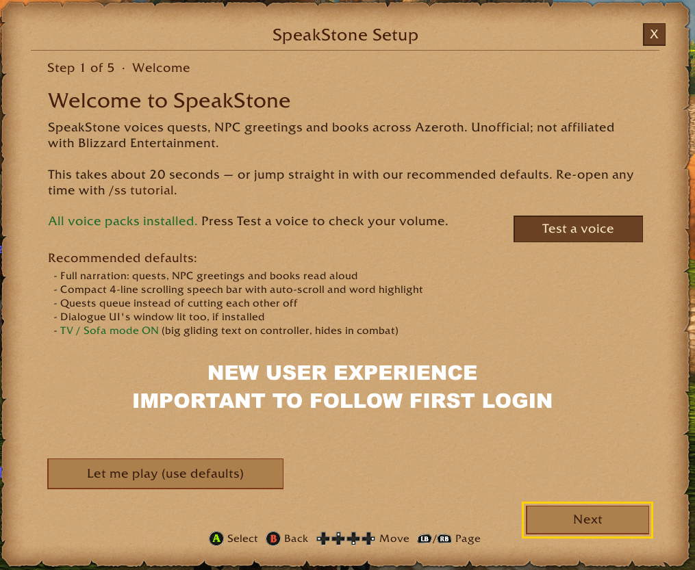

- **Quests, greetings and books, voiced.** Quest text (description, progress, completion), NPC greetings and book pages.
- **Choose how it reads.** Full narration, story only, Blizzard's own voice acting first, or manual (press Play).
  Show a compact speech bar, subtitles or nothing at all, with a portrait or a moving 3D head of the speaker.
- **Walk away and keep listening.** The speech bar carries on after you leave the NPC. Talk to someone else and their
  line waits its turn instead of cutting the first one off.
- **Read-along.** The words being spoken are highlighted as the voice reads them.
- **Pause and Resume** pick up from where you stopped.
- **Controller and TV support.** Xbox and PlayStation button prompts, big text for playing from the sofa, a rumble when
  a quest is queued, and a tutorial you can finish without a mouse.
- **Dialogue UI support.** Its play button plays SpeakStone, its text follows the voice, and quests queue or wait in combat.
- **Dyslexia-friendly fonts** (Atkinson Hyperlegible, Lexend, Andika, OpenDyslexic and more) and Parchment, Stone and
  Midnight themes.
- **The SpeakStone Guide.** Browse and play every voiced quest, greeting and book in game.
- **Help fill the gaps.** Lines with no voice yet are noted as you play, so they can be added.

| | |
|---|---|
| 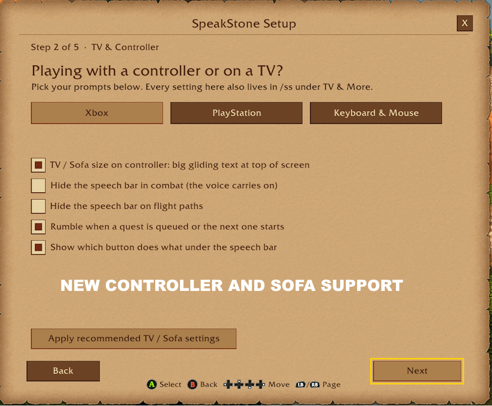 | 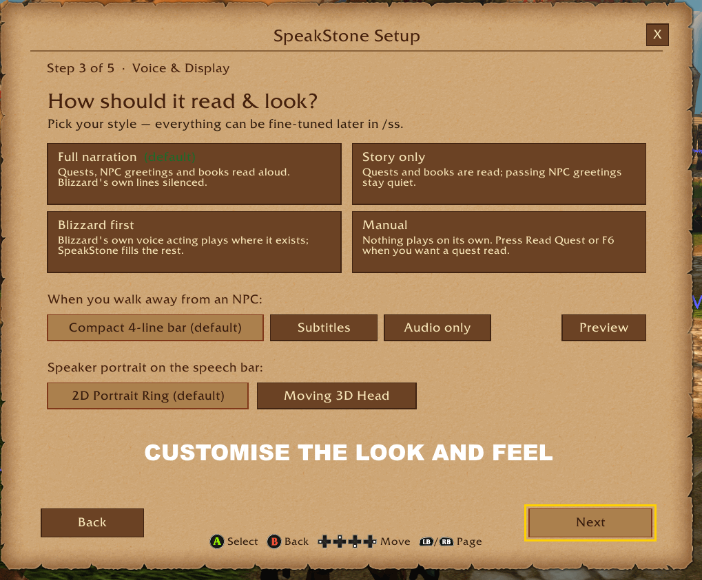 |
| Controller and TV support | Choose how it reads |
| 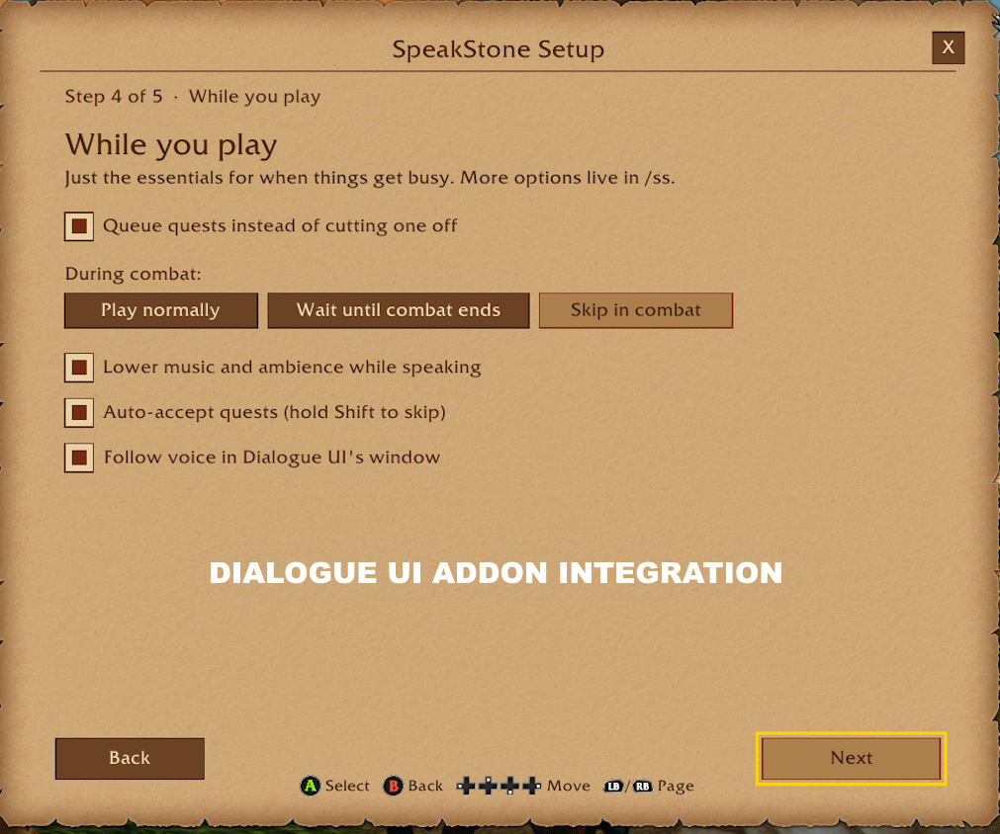 | 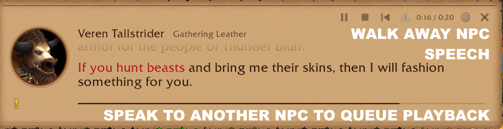 |
| Dialogue UI support | Walk away, keep listening |
| 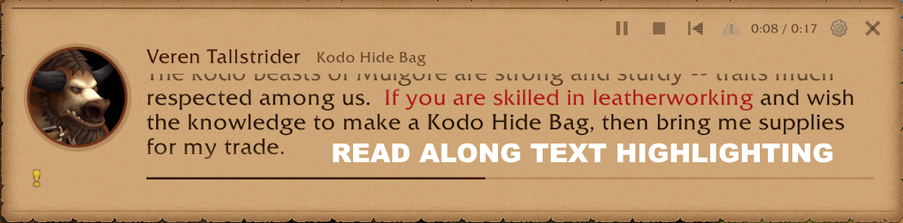 | 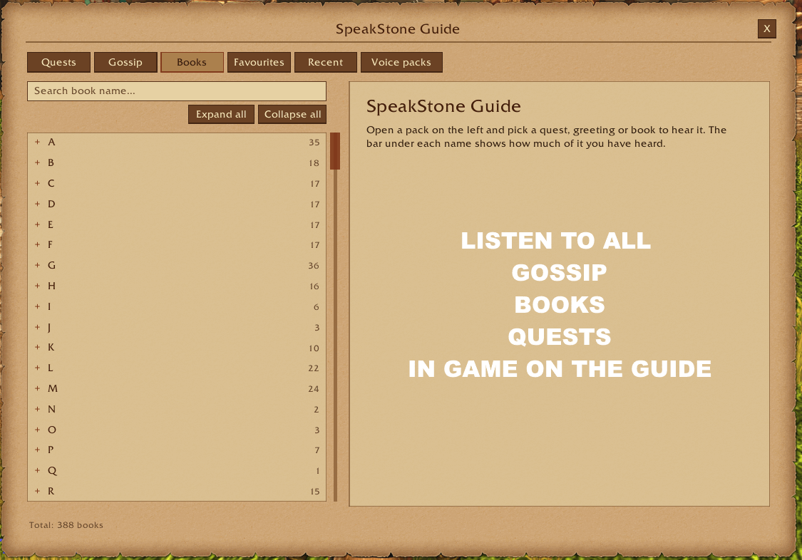 |
| Read-along highlighting | The SpeakStone Guide |
| 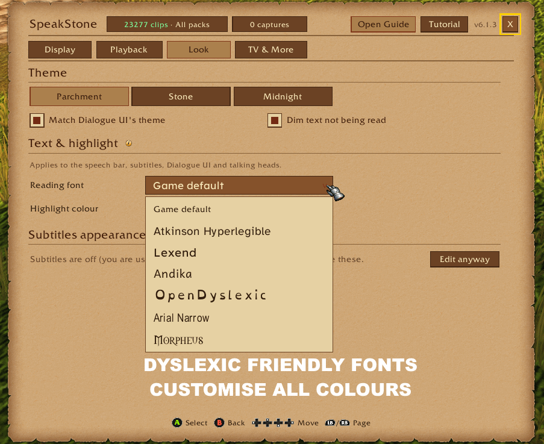 | 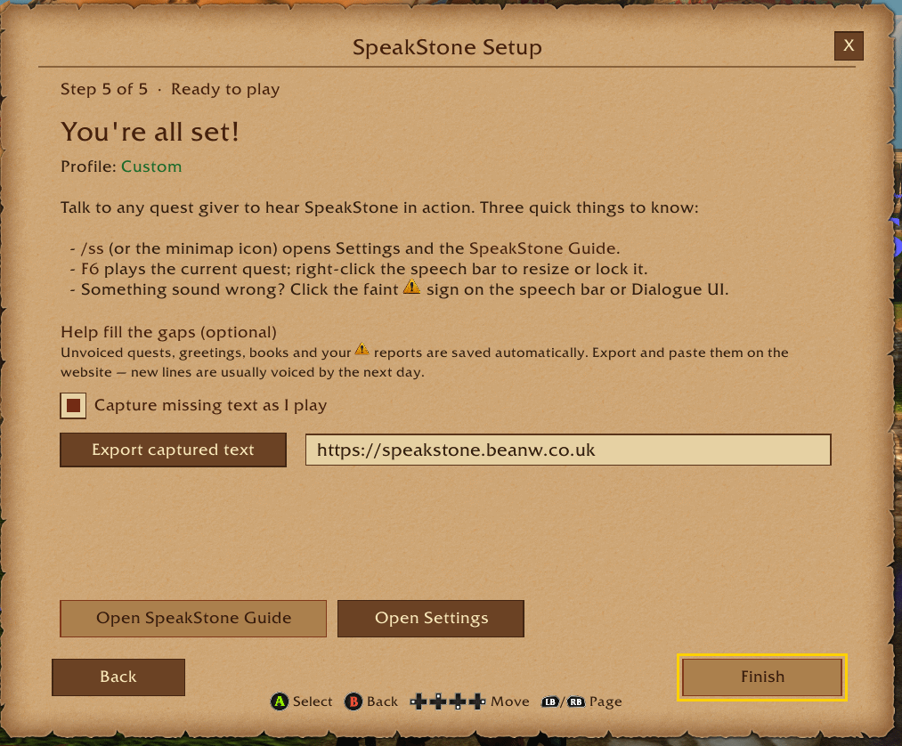 |
| Dyslexia-friendly fonts and themes | Help fill the gaps |

## How it works

1. **This add-on is the player.** It holds the code, the settings, the Guide and the quest and book text, but no audio.
2. **The voice packs hold the audio.** Each pack is its own add-on (one per expansion, plus Chatter Part 1 and 2 for greetings and books) and registers its lines with this
   add-on when the game loads. Install the packs for the content you play; a line whose pack is missing is simply silent.
3. **When a quest, greeting or book opens**, SpeakStone looks the line up by quest ID and part (description, progress,
   completion), by NPC and greeting, or by book and page, and plays it if a pack has it. Long lines are stored in parts
   of about 10 to 15 seconds, cut in natural pauses, so Pause and Resume can carry on from where you stopped.
4. **Lines with no voice yet are saved as you play** (quest text, greetings and book pages, and who said them). Export
   them from the minimap button (right-click) and paste them on the [website](https://speakstone.beanw.co.uk), or let
   the free SpeakStone Worker app send them for you. New lines are usually voiced by the next day and arrive in the
   packs with their next update.

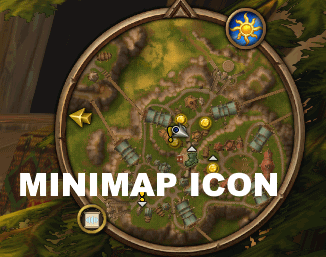 

### Commands

| Command | What it does |
|---|---|
| `/ss` | Settings and the Guide |
| `/ss tutorial` | Run the setup tutorial again |
| `/ssauto on` or `off` | Autoplay on or off |
| `/ssmissing` | Text captured for quests with no voice, ready to paste on the website |
| `/ssharvest export` | Export everything captured (also: right-click the minimap button) |
| `/qrlibrary` | The Guide |

Minimap button: left-click opens Settings, right-click exports captured text, middle-click toggles chat messages.

## The website and the Worker

[speakstone.beanw.co.uk](https://speakstone.beanw.co.uk): paste the text you captured so it gets a voice, hear samples,
and get the Worker.

The **SpeakStone Worker** (optional, Windows and Linux) keeps your SpeakStone add-ons up to date, sends the text you
capture, and can lend your graphics card to make new lines while the PC is idle. It steps aside whenever another
program needs the card. You can also **lend your voice**: record a couple of minutes on the website and it can be used
for characters in SpeakStone. Free, a person listens to every take, and you can withdraw at any time.

| | |
|---|---|
| 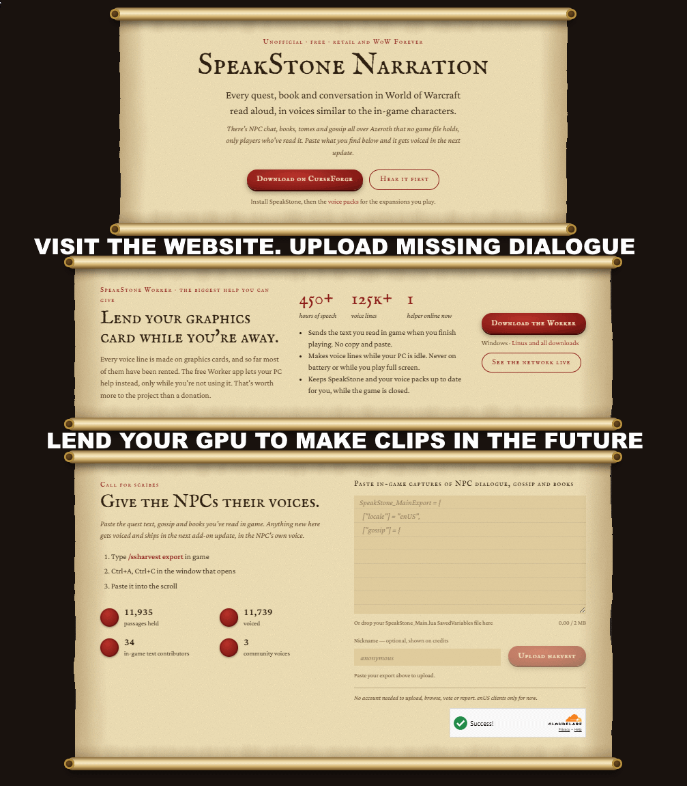 | 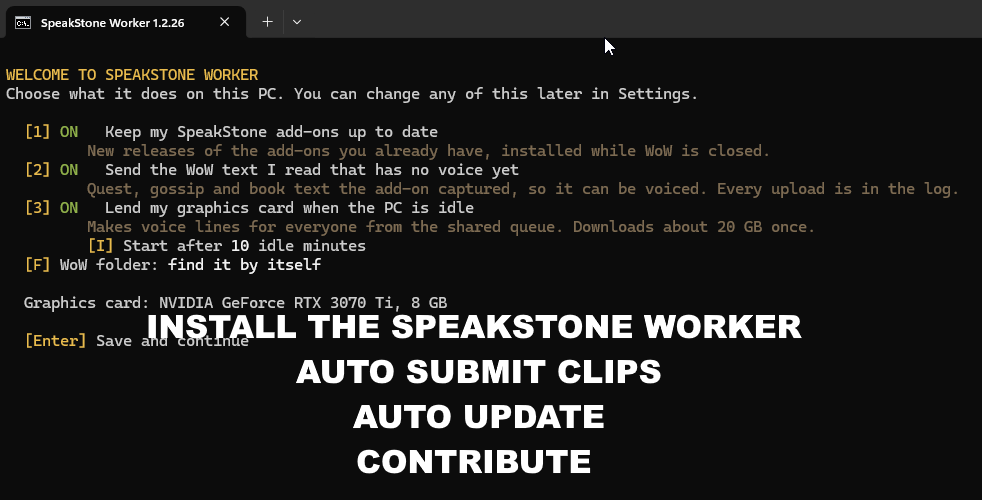 |
| The SpeakStone website | SpeakStone Worker setup |
| 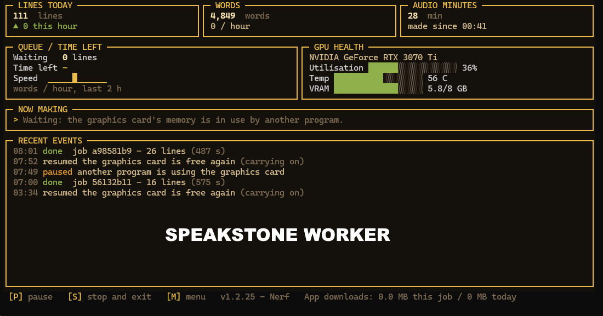 | 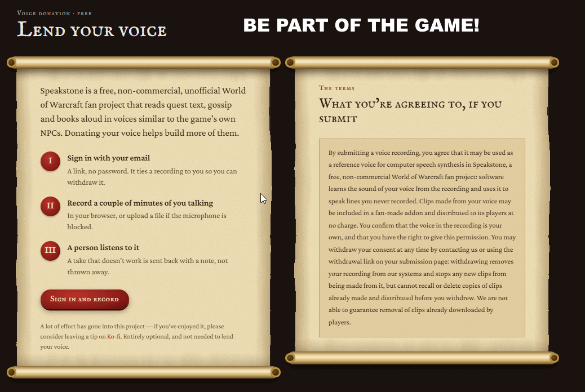 |
| The Worker at work | Lend your voice |

## Install

1. **SpeakStone** (this add-on: code, no audio).
2. The voice packs for the content you play, each its own add-on:
   Classic Part 1 and 2, The Burning Crusade, Wrath of the Lich King, Cataclysm Part 1 and 2, Mists of Pandaria,
   Warlords of Draenor, Legion, Battle for Azeroth, Shadowlands, Dragonflight, The War Within, Midnight, and
   **Chatter Part 1 and 2** (NPC greetings and books: without them nearly every greeting and book is silent).

The tutorial and the Guide's Voice packs tab list any pack you are missing.

Playing **WoW Forever**? Use [SpeakStone Forever](https://github.com/dandwhelan/SpeakStone_Forever_Main) instead.

## Releases

A pushed `vX.Y.Z` tag packages the add-on for CurseForge and Wago (`.github/workflows/release.yml`). Code pushed here is
copied to SpeakStone Forever as a pull request (`sync-forever.yml`). Changes: [CHANGELOG.md](CHANGELOG.md).

Unofficial; not affiliated with Blizzard Entertainment.
